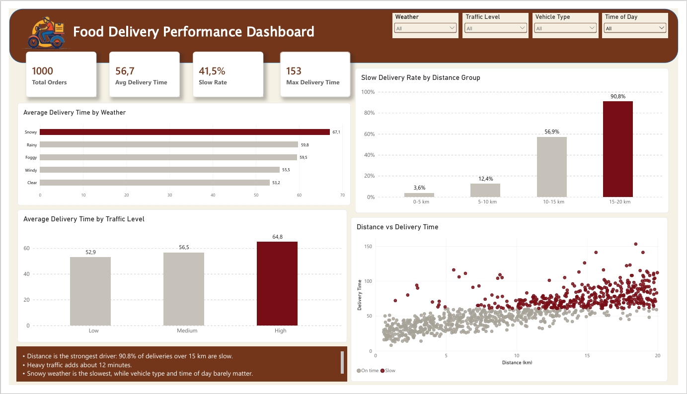

# 🛵 Food Delivery Time Analytics

Python (EDA) and Power BI analysis of the factors that make food deliveries slow.

## 📊 Dashboard Preview



---

## 🎯 Business Problem

**Primary question:** "What factors make food deliveries slow, and what can the company do to make them faster?"

**Key objectives**
1. Identify the factors that affect delivery time the most.
2. Describe patterns in delivery time by distance, traffic, weather, time of day, and vehicle type.
3. Provide data-driven recommendations to reduce slow deliveries.

---

## 🗂️ Dataset

- **Source:** "Food Delivery Time Prediction" dataset on Kaggle (simulated but realistic data, not real company records).
- **Size:** 1,000 orders and 9 columns. One row is one delivered order.
- **Target variable:** `Delivery_Time_min`.
- **Slow delivery definition:** an order that takes **more than 60 minutes** (analyst assumption, close to the average of 56.7 minutes).

| Column | Description |
|---|---|
| `Order_ID` | Order identifier |
| `Distance_km` | Distance from restaurant to customer (km) |
| `Weather` | Clear, Rainy, Foggy, Snowy, Windy |
| `Traffic_Level` | Low, Medium, High |
| `Time_of_Day` | Morning, Afternoon, Evening, Night |
| `Vehicle_Type` | Bike, Scooter, Car |
| `Preparation_Time_min` | Time the restaurant needs to prepare the food (minutes) |
| `Courier_Experience_yrs` | Courier experience (years) |
| `Delivery_Time_min` | Total delivery time (minutes) |

**🧰 Tools:** Python (pandas, numpy, matplotlib, seaborn) in Google Colab, and Power BI Desktop.

---

## 🧹 Data Understanding and Preprocessing

**Data quality checks**
- **Missing values:** 30 empty values in each of 4 columns (`Weather`, `Traffic_Level`, `Time_of_Day`, `Courier_Experience_yrs`). In total 117 rows (11.7%) have at least one empty value.
- **Duplicates:** none (no duplicate rows and no duplicate `Order_ID`).
- **Value ranges:** no impossible values. Distance 0.59-19.99 km, preparation time 5-29 minutes, courier experience 0-9 years, delivery time 8-153 minutes.
- **Outliers:** 6 orders took more than 116 minutes (upper limit from the IQR method: Q3 + 1.5 x IQR = 71 + 1.5 x 30). All of them are long-distance orders (about 14.8-19 km).

**Decisions**
- Empty values were **filled instead of dropped**, because dropping would remove 11.7% of the data. Categorical columns use the most frequent value (`Weather` = Clear, `Traffic_Level` = Medium, `Time_of_Day` = Morning) and the numeric column uses the median.
- The 6 outliers were **kept**, because they are rare and realistic (long distance), not input errors.

**Feature engineering**
- `Slow_Delivery`: 1 if delivery time is more than 60 minutes, otherwise 0.
- `Distance_Group`: 0-5 km, 5-10 km, 10-15 km, 15-20 km.
- Helper columns for the dashboard: `Delivery_Status`, `Traffic_Order`, `Distance_Order`, `TimeOfDay_Order` (used for labels and sorting in Power BI).

---

## 🔍 Exploratory Data Analysis and Key Insights

Out of 1,000 orders, **415 (41.5%) were slow**. Average delivery time is 56.7 minutes (median 55.5, maximum 153).

### 📏 1. Distance is the strongest factor
Correlation with delivery time: 0.78.

| Distance group | Average delivery time | Slow delivery rate |
|---|---|---|
| 0-5 km | 34.3 min | 3.6% |
| 5-10 km | 49.0 min | 12.4% |
| 10-15 km | 63.4 min | 56.9% |
| 15-20 km | 79.4 min | 90.8% |

Each extra kilometer adds about 3 minutes (trend line slope 3.03).

### 🚦 2. Heavy traffic adds about 12 minutes

| Traffic level | Average delivery time | Slow delivery rate |
|---|---|---|
| Low | 52.9 min | 36.3% |
| Medium | 56.5 min | 40.2% |
| High | 64.8 min | 54.3% |

### 🌧️ 3. Bad weather slows deliveries, snow the most

| Weather | Average delivery time |
|---|---|
| Clear | 53.2 min |
| Windy | 55.5 min |
| Foggy | 59.5 min |
| Rainy | 59.8 min |
| Snowy | 67.1 min |

The slow delivery rate is 59.8% in snow versus 35.6% in clear weather.

### 🔥 4. Distance and traffic together

Slow delivery rate (%) by distance group and traffic level:

| Distance group | Low | Medium | High |
|---|---|---|---|
| 0-5 km | 3.3 | 1.8 | 8.5 |
| 5-10 km | 6.2 | 12.9 | 25.6 |
| 10-15 km | 44.9 | 59.0 | 72.2 |
| 15-20 km | 84.9 | 92.4 | 100.0 |

Long-distance orders are already often slow even when traffic is low (84.9% at 15-20 km), and high traffic makes every distance group worse.

### 🍳 5. Preparation time has a moderate effect
Correlation is 0.31, and each extra minute of preparation adds about 0.9 minutes to delivery time.

### ➖ 6. Little effect
Time of day (55.2-57.5 min on average) and vehicle type (56.0-58.2 min). Courier experience has a small effect (correlation -0.09, about -0.7 minutes per year of experience).

---

## 💡 Recommendations

| No | Recommendation | Supporting data |
|---|---|---|
| 1 | Handle long-distance orders first (service radius, nearest courier, extra pickup points) | 90.8% of orders at 15-20 km are slow |
| 2 | Show realistic delivery time estimates based on distance | 34.3 min at 0-5 km vs 79.4 min at 15-20 km |
| 3 | Prepare for heavy traffic (alternative routes, dynamic estimates) | High traffic: 64.8 min and 54.3% slow, vs Low traffic: 52.9 min and 36.3% slow |
| 4 | Prepare for bad weather (longer estimates, courier incentives) | Snowy: 67.1 min and 59.8% slow, vs Clear: 53.2 min and 35.6% slow |
| 5 | Coordinate restaurants and couriers so preparation does not hold up delivery | Each extra preparation minute adds about 0.9 minutes |

Vehicle type and time of day do not need to be a priority, since the data shows little difference.

---

## 📈 Dashboard (Power BI)

The dashboard (see the preview at the top) has:
- **4 KPI cards:** Total Orders, Avg Delivery Time, Slow Rate, Max Delivery Time.
- **4 visuals:** Average Delivery Time by Weather, Slow Delivery Rate by Distance Group, Average Delivery Time by Traffic Level, and a scatter plot of Distance vs Delivery Time (slow orders highlighted).
- **4 interactive filters:** Weather, Traffic Level, Vehicle Type, Time of Day.
- **Key insights box** summarizing the main findings.

The dataset has no date column, so the "trend" view is shown across distance groups instead of over time. Highlight colors: gray for normal values and dark red for the values that need attention.

**DAX measures**

```
Total Orders = COUNTROWS(Food_Delivery_Clean)
Avg Delivery Time = AVERAGE(Food_Delivery_Clean[Delivery_Time_min])
Slow Rate = AVERAGE(Food_Delivery_Clean[Slow_Delivery])
Max Delivery Time = MAX(Food_Delivery_Clean[Delivery_Time_min])
```

---

## ⚠️ Limitations

- The data is simulated, so findings are patterns from public data and should be validated with real operational data before use.
- The 60-minute threshold for "slow" is an assumption. A different threshold changes the percentages.
- Correlation shows a relationship, not proof of cause and effect. The effect of each recommendation should be tested (for example with an A/B test).
- Empty values in 4 columns were filled with the most frequent value or the median.

---

## 📁 Repository Files

| File | Description |
|---|---|
| `food_delivery_analytics.ipynb` | Python notebook: data understanding, cleaning, EDA, and insights |
| `Food_Delivery_Dashboard.pbix` | Power BI dashboard |
| `food_delivery_dashboard.jpeg` | Dashboard screenshot |
| `Food_Delivery_Times.csv` | Original dataset |
| `Food_Delivery_Clean.csv` | Cleaned dataset used in the dashboard |

---

👩‍💻 **Author:** Anis Tri Mailani
